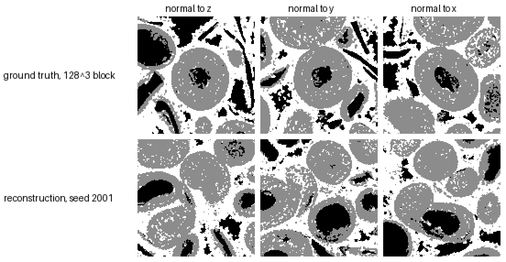

# Reconstructing 3D porous microstructures from 2D images by voxel-wise variational score distillation

Code for the paper *Reconstructing three-dimensional porous microstructures from two-dimensional images by voxel-wise
variational score distillation* (Zhu and Wang, submitted to npj Computational Materials).

A 2D denoising diffusion model (the *judge*) is trained on crops of the 2D images. A segmented 3D volume is then optimised
directly from noise so that its planar sections of every orientation follow the distribution the judge has learned, using the
variational score distillation (VSD) gradient with an online second model. No 3D training volumes, no 3D generator and no
descriptor beyond the phase fractions are used.

This repository is the minimal runnable version: the five scripts of the pipeline and one worked example, the three-phase
Savonnières limestone (macropores, microporous ooids and shell moulds, calcite).

## Files

| file | purpose |
|---|---|
| `make_gt.py` | downscales the whole segmented volume to the judge's scale (per-phase linear resampling, then argmax); the 3D ground truth for the evaluation |
| `build_rock_dataset_mp.py` | training crops from a few 2D slices of the volume: same downscaling, 360 rotation angles, valid-region crops, label maps 0..K−1 |
| `train_diffusion_mp.py` | trains the K-phase judge, an inpainting-conditioned DDPM (U-Net and schedule in `train_diffusion.py`, masks in `util/mask.py`, K-phase layers in `multiphase_common.py`) |
| `recon_vsd_voxel_mp.py` | the reconstruction: periodic cell, sections of every orientation, straight-through hard labels, VSD with a decoder-trained online model, phase-fraction multipliers, running-average output |
| `eval_mp2.py` | evaluation against the 3D ground truth: phase fractions, mean chords, interface densities, normalised autocovariance error, specks, largest-cluster share and pore bodies on 128³ blocks |
| `gpu_guard.py` | caps the CUDA allocator below the VRAM size (imported by the training and reconstruction scripts) |
| `run_savonnieres.sh` | the example below, end to end |

## Installation

Python 3.12, PyTorch 2.4 or later with CUDA, `pip install -r requirements.txt`. The example needs one GPU with 16 GB
(peak allocation 14.3 GB) and about 8 GB of RAM for the ground-truth volume.

## Example: Savonnières limestone, 128² judge

Data: the segmented micro-CT volume of Digital Rocks Portal project 72 (Savonnières carbonate, 1000³ voxels, three phases
with raw values 0 macropore, 1 microporous, 9 calcite), file `SAVII2_mid_1000x1000x1000x8b-3phase-cleaner.dat`. Everything
runs at 2.5× downscaling (400³ ground truth). The judge sees seven slices only, one orthogonal set near each face and the
centre; the reconstruction is compared with the whole 400³ volume, which the judge never sees.

```bash
# 0. ground truth at the judge's scale (400^3)
python make_gt.py --raw SAVII2_mid_1000x1000x1000x8b-3phase-cleaner.dat --shape 1000 1000 1000 --phases 0,1,9 --scale 2.5 \
    --out data/rocks/sav3_gt_labels.npy
# 1. training crops: seven slices at 2.5x, 128^2 crops, every angle and position equally likely (23 772 crops)
python build_rock_dataset_mp.py --raw SAVII2_mid_1000x1000x1000x8b-3phase-cleaner.dat --shape 1000 1000 1000 --phases 0,1,9 \
    --name sav3 --slices z:200,z:500,z:800,y:300,y:700,x:300,x:700 --scale 2.5 --crop 128 --per-angle 13 --max-crops 24000 --axis-mode random
# 2. judge: 20 000 steps, batch 16, unconditional mode in half of the samples (30 min on an RTX 5090)
python train_diffusion_mp.py --data data/rocks/sav3_tensor.pt --n-phases 3 --steps 20000 --save-every 0 --all-unknown-prob 0.5 \
    --output data/rocks/outputs_diffusion_sav3 --checkpoint data/rocks/checkpoints_diffusion_sav3
# 3. reconstruction: periodic 192^3 cell, 128^3 output, 24 sections per step, 8000 steps (34 min, 14.3 GB)
python recon_vsd_voxel_mp.py --data data/rocks/sav3_tensor.pt --model data/rocks/checkpoints_diffusion_sav3/ema.pth --n-phases 3 \
    --size 192 --crop-out 128 --sections 24 --micro-batch 24 --micro-sleep-ms 0 --ramp-steps 0 --duty 1.0 \
    --ema 0.9975 --frac-lambda-rate 1e-6 --fake-train decoder --iters 8000 --ckpt-every 1000 --resume \
    --seed 2001 --output data/rocks/recon_sav3_s2001
# 4. evaluation against the 3D ground truth (prints the table below; --sheet writes a section montage)
python eval_mp2.py --gt data/rocks/sav3_gt_labels.npy --recon data/rocks/recon_sav3_s2001/labels.npy --pore-phase 0 \
    --name sav3_s2001 --json data/rocks/eval_sav3_s2001.json --sheet data/rocks/eval_sav3_s2001.png
```

`run_savonnieres.sh` runs the five steps (`RAW=path/to/file.dat SEED=2001 bash run_savonnieres.sh`). The reconstruction
checkpoints every 1000 steps and `--resume` continues an interrupted run. The output `labels.npy` is the 128³ central block
of the running average, `labels_full.npy` the whole periodic cell.

### Result

Three runs with seeds 2001, 2002 and 2003 (judge and training crops fixed; the runs differ in the initial volume and the
random planes and noise). Normalised quantities are computed on the whole output and compared with the whole 400³ ground
truth; the block column is the range over eight random 128³ blocks of the ground truth as printed by `eval_mp2.py`, the
variation a perfect 128³ reconstruction would show. Connectivity and pore bodies are measured on 128³ blocks (26-connectivity).
Phases: 1 macropore, 2 microporous, 3 calcite.

| quantity | ground truth, 400³ | 128³ blocks of the ground truth | reconstruction, 128³ (mean ± s.d., 3 seeds) |
|---|---|---|---|
| phase fraction 1 / 2 / 3 | 0.225 / 0.391 / 0.384 | 0.14–0.26 / 0.33–0.46 / 0.35–0.44 | 0.209 ± 0.019 / 0.432 ± 0.026 / 0.359 ± 0.008 |
| mean chord 1 / 2 / 3 (voxels) | 8.7 / 6.8 / 6.9 | 6.5–10.4 / 5.3–7.8 / 5.9–7.1 | 7.8 ± 0.2 / 6.5 ± 0.4 / 5.7 ± 0.1 |
| autocovariance max. error 1 / 2 / 3 | 0 / 0 / 0 | 0.04–0.13 / 0.02–0.06 / 0.02–0.05 | 0.052 ± 0.010 / 0.032 ± 0.013 / 0.030 ± 0.002 |
| macropore share in its largest cluster | – | 0.52–0.84 (mean 0.70) | 0.66 ± 0.17 |
| macropore bodies ≥ 27 voxels per 128³ | – | 70–126 (mean 86) | 56 ± 7 |

Central sections of a 128³ block of the ground truth and of the seed-2001 reconstruction (black macropore, grey
microporous, white calcite):



In the paper this configuration is the seven-slice, 128²-judge limestone row of the supplementary tables and the baseline of the
ablations; the main-text limestone result uses a 256² judge trained on 40 slices (`--crop 256`, 40 000 steps, batch 12) with
`--size 320 --crop-out 256 --sections 8 --micro-batch 8 --ema 0.99917 --frac-lambda-rate 3.3e-7 --iters 40000`.
Ablations of the paper: `--grad-mode sds` (no online model), `--plane-mode axis` (axis-aligned sections only).

## Citation

To be added on publication.
